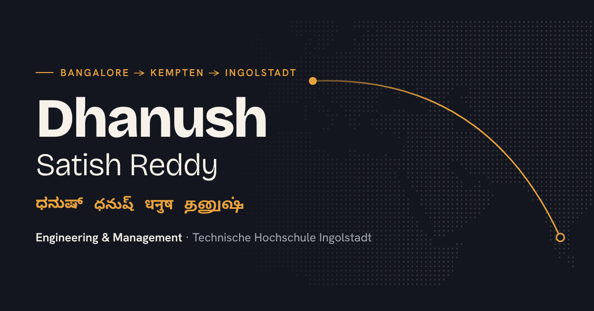

# Dhanush Satish Reddy

**Engineering and Management student at Technische Hochschule Ingolstadt (THI).**
From Bangalore via Kempten to Ingolstadt: three cities, seven languages, one portfolio.

🌐 **Live site:** [dhanush-satish-reddy.github.io](https://dhanush-satish-reddy.github.io)
🇬🇧 English version: [dhanush-satish-reddy.github.io/?lang=en](https://dhanush-satish-reddy.github.io/?lang=en)
💼 LinkedIn: [linkedin.com/in/dhanushreddy05](https://www.linkedin.com/in/dhanushreddy05)



---

## What's on the site

The whole portfolio is told as a story, in my own voice, in **German and English**.

| Section | What it shows |
|---|---|
| **Hero** | My first name animating through Kannada, Telugu, Hindi and Tamil before landing on *Dhanush*. Visitors can tap each script to switch. |
| **Prologue** | A short introduction to who I am and how the story is told. |
| **Story** | Three chapters, from today backwards: *Vollgas* (Ingolstadt), *Neue Sprache, neue Perspektive* (Kempten), *Die Wurzeln* (Bangalore). Next to them, a passport page with engraved postage stamps of each city's landmark: Kreuztor, Basilika St. Lorenz and Vidhana Soudha. |
| **Tabs** | One tap gathers everything of one kind from all three cities: work, internships, education, certificates or awards. |
| **Languages** | Seven languages, each with a greeting and an honest level. |
| **Certificates** | AI, cloud and data certificates. |
| **Projects** | Things I've built, starting with [Recruiter-Me](https://dhanush-satish-reddy.github.io/recruiter-me/), a free AI interview coach. |
| **Contact** | Email and LinkedIn. |

The design uses one palette throughout: deep ink, warm paper and marigold. Every institution logo is recoloured to match.

---

## Files

| File | Purpose |
|---|---|
| `index.html` | The entire website: layout, styles, texts and behaviour in one file. |
| `photo.png` | Portrait in the hero. |
| `og.png` | Preview image (1200 × 630) that LinkedIn, WhatsApp and others show when the link is shared. |
| `*.png` logos | Institution and award logos (THI, Schanzer Racing Electric, FDI, Christ, Ace Micromatic, FOSBOS Kempten, IFM, Bavarian Police, telc, Zara, Sarvodaya NPS, ITA, basketball, karate), recoloured to the site's palette. They sit next to `index.html`. |

No build step, no frameworks, no dependencies: GitHub Pages serves the files exactly as they are.

---

## How to update the site

Everything is edited inside `index.html`. Open it on GitHub, click the ✏️ pencil, change the text and click **Commit changes**. The live site updates after about a minute.

All the content sits in clearly named blocks near the bottom of the file. Each text has a German (`de`) and an English (`en`) version:

| Block | Contains |
|---|---|
| `JOURNEY` | The three city chapters: their story paragraph and every job, school, internship and award. |
| `LANGUAGES` | The seven language cards. |
| `CERTIFICATES` | The certificate list. |
| `TEXT` | Every other piece of text on the page, for example headings, the prologue, buttons and the contact line. |

### Add a new job, course or award

Copy an existing entry in `JOURNEY` into the right city and change its details:

```js
{ type: "work", start: "2026-12", end: null,
  title: { de: "Werkstudent Vertrieb", en: "Working Student, Sales" },
  org: "Company name, City", logo: "company.png",
  desc: { de: "Was ich dort mache …", en: "What I do there …" } },
```

- **`type`** is one of `work`, `team`, `mentor`, `intern`, `study`, `school`, `lang` or `award`. It decides the label and which tab the entry appears in.
- **`start` / `end`** use the format `"YYYY-MM"`. `end: null` means *ongoing*.
- **`logo`** is optional. Upload the image next to `index.html` and write its file name here. Without a logo, a small marigold dot is shown.
- Entries are sorted newest first automatically.

### Change the photo or preview image

Upload a new file with exactly the same name (`photo.png` or `og.png`) and GitHub replaces the old one. LinkedIn can keep showing an old preview for a while. Pasting the link into the [LinkedIn Post Inspector](https://www.linkedin.com/post-inspector/) refreshes it.

---

## Credits

Content, text and photo © Dhanush Satish Reddy.
Logos belong to their respective organisations and are shown only to mark where I studied, worked or competed.
Fonts: Bricolage Grotesque, Hanken Grotesk and Noto Sans (via Google Fonts).
